

  

  

  

  
  
  


  


  

  


<!-- Party Parrot parade · https://cultofthepartyparrot.com/ -->

  
  
  
  
  
  
  
  
  
  
  
  
  
  
  
  
  
  
  
  
  
  

  
  


  


<picture>
  <source media="(prefers-color-scheme: dark)" srcset="https://raw.githubusercontent.com/nvkdzvcl/nvkdzvcl/main/dist/pacman-contribution-graph-dark.svg" />
  <source media="(prefers-color-scheme: light)" srcset="https://raw.githubusercontent.com/nvkdzvcl/nvkdzvcl/main/dist/pacman-contribution-graph.svg" />
  
</picture>

<b>🏙️ My Contribution City — open to explore</b>

 

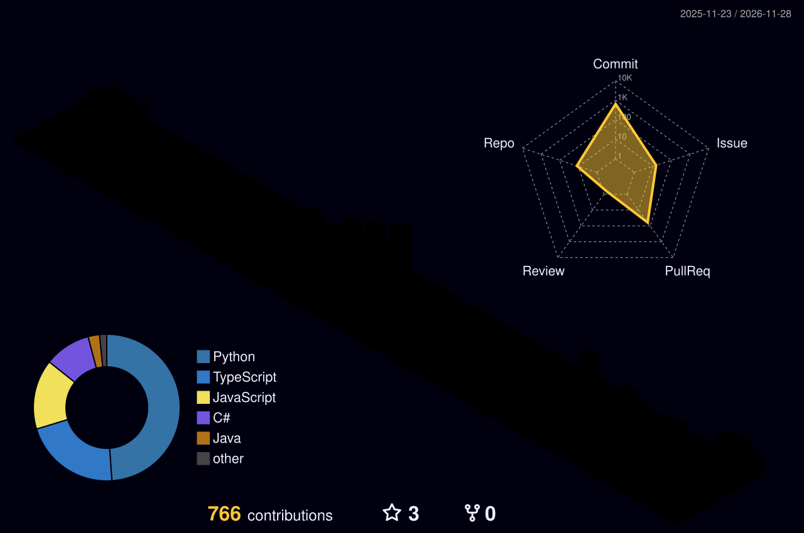

<b>🔎 Behind the Vibes — languages & activity</b>

 

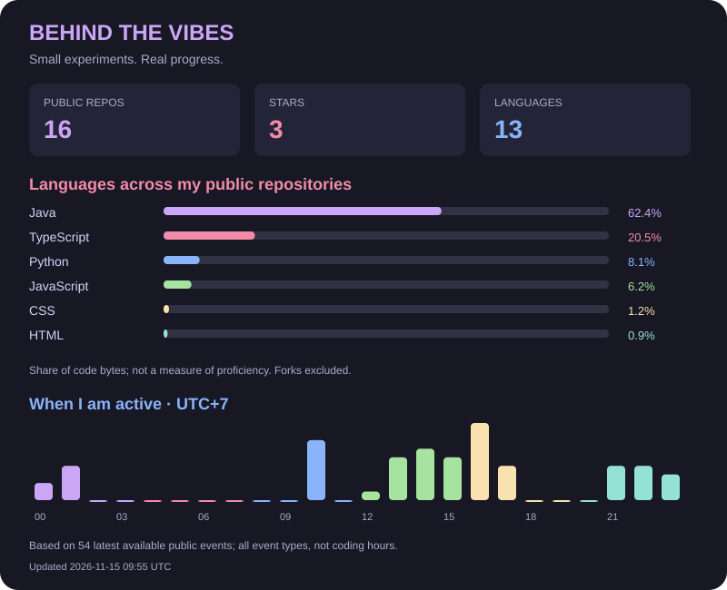

Languages reflect repository contents; activity charts reflect available GitHub data.

Đừng bấm vào đây 👀

 

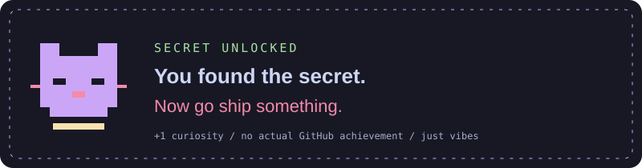

Ideas in. Projects out. Powered by curiosity and AI.

